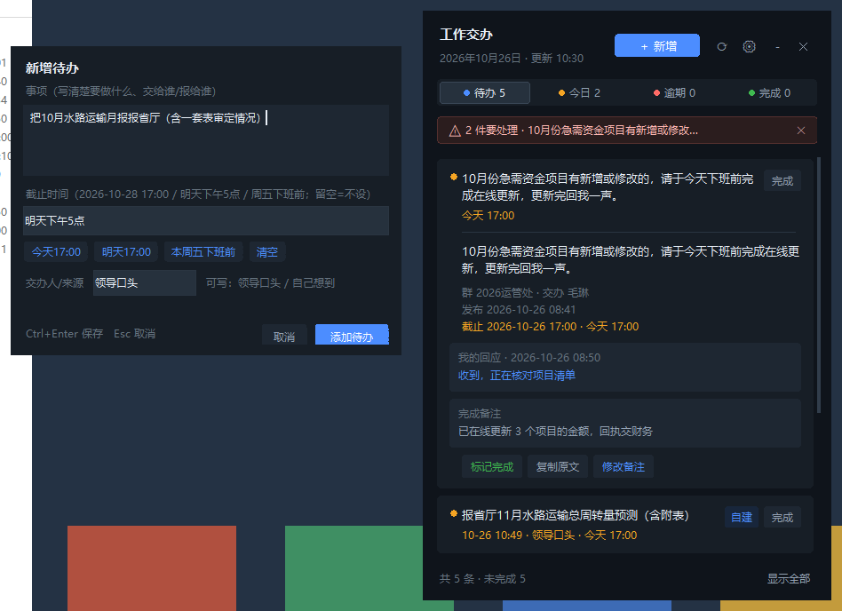
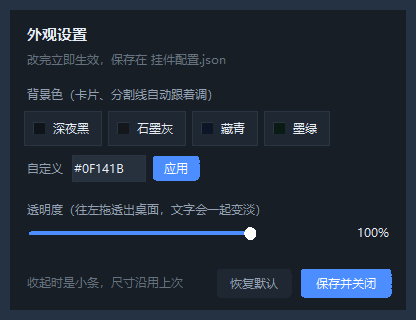
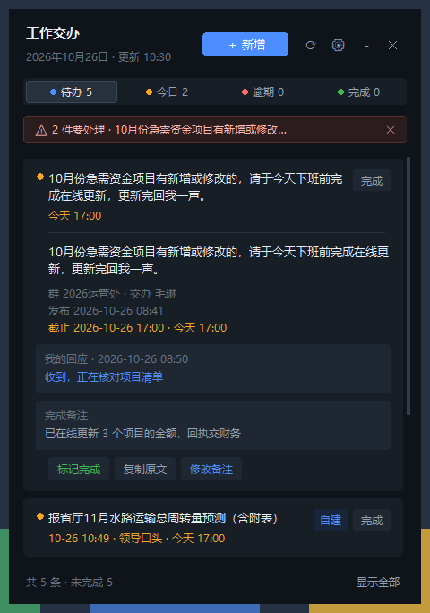

# 工作交办挂件 · work-todo-widget

一个常驻桌面的待办小挂件：把「微信群里的工作交办」和「自己随手加的待办」合成一张清单，带到期提醒、完成备注、自建待办、可调背景色和透明度。

深色单窗设计：圆角卡片、分段筛选条、自绘细滚动条、空状态引导，全部用 Tkinter Canvas 画，不依赖第三方 UI 库。

Windows + Python 3.9+ + Tkinter 单文件，无需安装依赖（Pillow 可选，仅用于显示图片缩略图）。



收起时是一条 320×80 的小条，不挡桌面；外观（背景色、透明度）在 `⚙` 里调：

| 收起小条 | 外观设置 |
| --- | --- |
|  |  |

展开后的列表样子：



## 界面约定

- **三级层级**：标题 11pt 粗 / 正文 10pt / 辅助 9pt；颜色只有主文本、次要、辅助三档，加蓝（新到、操作）、黄（今日）、红（逾期）、绿（完成）四个功能色
- **状态一眼可辨**：卡片左上小圆点 = 优先级，右上「完成」胶囊；自建待办带蓝色「自建」标；逾期/今日的截止时间整行变色
- **筛选**：顶部四段（待办 / 今日 / 逾期 / 完成）点击即筛，选中段有描边高亮；底栏「显示全部」切全量
- **空状态**：每栏为空时给出提示和「＋ 新增待办」按钮，不会只留一片黑
- **交互都有反馈**：卡片悬停变亮、按钮悬停换色、滚动条随位置移动

## 功能

- **清单合并**：读 `台账.json`（别人给你的微信群交办条目）+ `手工待办.json`（自己加的），一张列表统一排序：逾期 → 今日 → 新到 → 其他 → 已完成
- **新建待办**：标题栏「＋新增」、`Ctrl+N`、`⚙` 菜单三个入口；截止时间支持口语写法 `2026-10-28 17:00` / `明天下午5点` / `周五下班前` / `10月28日` / 留空不设
- **卡片操作**：标记完成 / 撤销、写完成备注、复制原文、展开看全文；自建待办还能编辑、删除
- **到期提醒**：截止前 30 分钟弹窗 + 提示音；逾期 3 天内的也在提醒范围（每天每条只提醒一次）
- **收起小条**：点「－」变成 320×80 的小条，只显示「待办 N · 逾期 N · 今日 N」，标题栏上仍可一键新增
- **外观可调**：`⚙ → 外观设置` 里换背景色（4 个预设 + 自定义 `#RRGGBB`，卡片/分割线色阶自动跟随），拖动透明度 35%–100% 透出桌面；设置存进 `挂件配置.json`
- **单实例**：反复点快捷方式不会开出第二个窗口
- **不吃数据**：完成状态、备注、自建待办分别存在独立文件里，重新生成台账不会丢

## 快速开始

```
你的台账目录\
├─ 台账.json          ← 交办条目（由你自己的抓取脚本生成，见下方格式）
├─ 完成状态.json      ← 挂件写：完成标记 + 备注
├─ 手工待办.json      ← 挂件写：自建待办
├─ 挂件配置.json      ← 挂件写：位置 / 置顶 / 背景色 / 透明度
└─ 桌面挂件\
   ├─ 任务挂件.py     ← 本程序（BASE 默认取它的上一级目录）
   ├─ 启动挂件.vbs
   └─ 挂件.ico
```

1. 把 `任务挂件.py` 放进 `<台账目录>\桌面挂件\`，或者随便放一个目录（此时 `BASE` 就是它的上一级目录）
2. 想用别的数据目录：设环境变量 `GJZB_HOME=D:\your\ledger`
3. 启动：双击 `启动挂件.vbs`（用 `pythonw.exe` 静默启动，不弹黑窗），或 `python 任务挂件.py` 看日志
4. 桌面快捷方式（可选）：
   ```powershell
   $ws = New-Object -ComObject WScript.Shell
   $lnk = $ws.CreateShortcut("$env:USERPROFILE\Desktop\工作交办挂件.lnk")
   $lnk.TargetPath = "$env:WINDIR\system32\wscript.exe"
   $lnk.Arguments = '"<台账目录>\桌面挂件\启动挂件.vbs"'
   $lnk.IconLocation = "<台账目录>\桌面挂件\挂件.ico,0"
   $lnk.Save()
   ```
   开机自启：把这个 `.lnk` 丢进 `shell:startup`

## 台账.json 格式

只要结构对得上，数据从哪来都行（本项目的抓取脚本是另一套东西，不包含在这个仓库里）。

```json
{
  "generated": "2026-10-26 09:22:00",
  "items": [
    {
      "id": "6eac5afe05fc",
      "group": "2026运管处",
      "from": "毛琳",
      "time": "2026-10-26 08:41",
      "text": "10月份急需资金项目有新增或修改的，请于今天下班前完成在线更新。",
      "deadline": "2026-10-26 17:00",
      "replied": "2026-10-26 08:50",
      "rtext": "收到",
      "done": false,
      "note": "",
      "prio": "today"
    }
  ]
}
```

- `id` 唯一即可（挂件用它关联 `完成状态.json`；自建待办用 `m` 开头的 id）
- `deadline` 格式 `YYYY-MM-DD HH:MM`，空串表示不设截止
- `prio` 会被挂件按当前时间重算，`overdue / today / new / open / done`
- 其余字段（`ctx`、`img`、`att` 等）有就显示，没有就跳过

## 手工待办.json 格式

```json
{
  "updated": "2026-10-26 09:14:00",
  "items": [
    {
      "id": "med9f53571c7",
      "group": "手动添加",
      "from": "领导口头",
      "time": "2026-10-26 09:14",
      "text": "报省厅11月水路运输总周转量预测（含附表）",
      "deadline": "2026-10-30 17:00",
      "manual": true
    }
  ]
}
```

正常用界面加就行，手改文件也认（挂件每次刷新都会重新读）。

## 交互速查

| 操作 | 位置 |
| --- | --- |
| 新增待办 | 标题栏「＋新增」/ `Ctrl+N` / `⚙` 菜单第一项 |
| 保存待办 | 弹窗里「添加待办」/ `Ctrl+Enter` / 截止时间框回车 |
| 关闭弹窗 | `Esc` |
| 展开 / 收起卡片 | 点卡片 |
| 卡片菜单 | 右键卡片（含编辑、删除自建待办） |
| 复制原文 | 双击卡片 |
| 收起挂件 | 标题栏「－」，再点一次展开 |
| 拖动位置 | 拖标题栏 |
| 外观设置 | `⚙` → 外观设置 |
| 刷新数据 | `⟳`（会调用 `<BASE>\工具\台账引擎.py --fetch`，没有就只重读 JSON） |

## 说明

- 只支持 Windows（用到了 `winsound`、`-alpha`、`wscript` 启动器）
- 透明度作用于整个窗口（文字也会一起变淡），最低 35%，以免看不清；弹窗保持不透明
- 单实例靠命名互斥量实现，调试时想开第二个：`python 任务挂件.py --force`

## License

MIT
